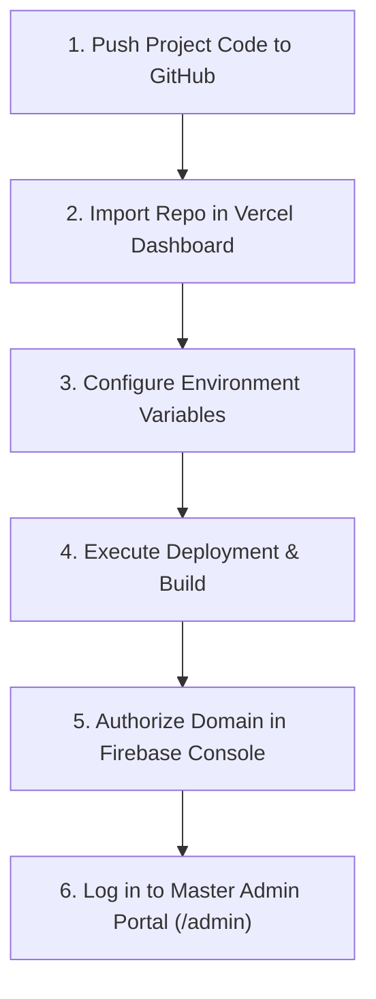

# EcoBela 2 — Complete Vercel Deployment & Configuration Guide

This guide provides step-by-step instructions to deploy the **EcoBela 2** Bangladeshi Sustainable Luxury Fashion & Lifestyle Next.js application to **Vercel**.

---

## 🏗️ Stack Architecture Overview

- **Framework:** Next.js 15 (App Router) & React 19
- **Styling:** Tailwind CSS v4 & PostCSS
- **State Management:** `ShopContext` (Dynamic Product, Category & Order persistence) & `AuthContext`
- **Authentication:** Seeded Admin Credentials + Firebase Auth (Google / Facebook / Email)
- **Deployment Platform:** Vercel (Frontend & Serverless Backend)

---

## 📋 Quick Step-by-Step Deployment Workflow



---

## Step 1: Push Code to GitHub / GitLab

1. Open your terminal in the project directory:
   ```bash
   git init
   git add .
   git commit -m "Initial commit - Ready for Vercel deployment"
   ```

2. Create a new repository on [GitHub](https://github.com/new).

3. Link your remote repository and push code:
   ```bash
   git remote add origin https://github.com/YOUR_USERNAME/EcoBela2.git
   git branch -M main
   git push -u origin main
   ```

---

## Step 2: Deploy to Vercel

### Option A: Via Vercel Dashboard (Recommended)

1. Sign in to [Vercel](https://vercel.com).
2. Click **Add New...** &rarr; **Project**.
3. Select your **GitHub** repository (`EcoBela2`) and click **Import**.
4. Vercel automatically detects **Next.js** framework settings:
   - **Framework Preset:** Next.js
   - **Root Directory:** `./`
   - **Build Command:** `next build`
   - **Output Directory:** `.next`

### Option B: Via Vercel CLI

1. Install Vercel CLI globally:
   ```bash
   npm i -g vercel
   ```
2. Run deployment in the project folder:
   ```bash
   vercel
   ```
3. Follow CLI prompts to confirm project settings.

---

## Step 3: Configure Environment Variables

Under **Project Settings &rarr; Environment Variables** in Vercel, configure the following keys (Optional: If omitted, the app runs cleanly in local state mode with demo admin access):

| Environment Variable | Description / Value |
|----------------------|---------------------|
| `NEXT_PUBLIC_FIREBASE_API_KEY` | Your Firebase API Key |
| `NEXT_PUBLIC_FIREBASE_AUTH_DOMAIN` | `your-project.firebaseapp.com` |
| `NEXT_PUBLIC_FIREBASE_PROJECT_ID` | `your-project-id` |
| `NEXT_PUBLIC_FIREBASE_STORAGE_BUCKET` | `your-project.appspot.com` |
| `NEXT_PUBLIC_FIREBASE_MESSAGING_SENDER_ID` | Your Firebase Sender ID |
| `NEXT_PUBLIC_FIREBASE_APP_ID` | Your Firebase App ID |

---

## Step 4: Admin Portal Access on Live Deployment

Once deployed, your live production website URL will be generated (e.g., `https://ecobela2.vercel.app`).

### 🔑 Master Admin Credentials:
- **Admin Portal Path:** `https://your-vercel-url.vercel.app/admin`
- **Admin Email:** `admin@ecobela.com`
- **Admin Password:** `admin123456`

> 💡 **Tip:** You can also click the **"Sign In as Demo Admin"** button at the login page (`/login`) for 1-Click Master Admin access on the live Vercel deployment.

---

## Step 5: Authorize Vercel Domain in Firebase (For Google/Facebook Login)

If you are using Firebase Auth for Google/Facebook popups on your live site:

1. Open [Firebase Console](https://console.firebase.google.com/).
2. Select your Firebase project &rarr; **Authentication** &rarr; **Settings**.
3. Go to **Authorized domains**.
4. Click **Add domain** and enter your Vercel URL (e.g. `ecobela2.vercel.app`).

---

## 🔧 Troubleshooting & Build Tips

### 1. Multiple Lockfiles Warning
Next.js may log a warning if parent folders contain duplicate `package-lock.json` files. To silence this on Vercel, ensure `package-lock.json` in the repository root is committed.

### 2. Tailwind CSS v4 `@import` Syntax
Ensure [app/globals.css](file:///c:/Users/nahid/OneDrive/Desktop/Regard%20Tech/EcoBela2/app/globals.css) maintains `@import url(...)` at line 1 prior to `@import "tailwindcss";` so PostCSS parses font imports and custom utilities (`scale-102`, `backdrop-blur-xs`, `shadow-xs`, etc.) correctly.

### 3. Continuous Deployment (CI/CD)
Any push to your `main` branch automatically triggers a fresh Vercel build:
```bash
git add .
git commit -m "Update products and categories"
git push origin main
```
Vercel updates the production deployment with zero downtime!
